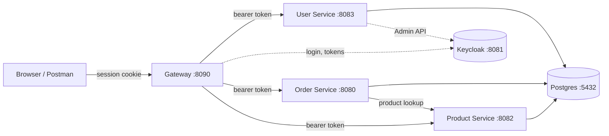

# secure-shop-platform

A small online shop backend, built to explore OAuth2, OpenID Connect and API security hands-on. Four Spring Boot services sit behind one API Gateway, and Keycloak is the only place users log in.

The browser never sees a token. It holds a session cookie, the Gateway keeps the tokens, and each service checks the token it receives on every request.



## Services

| Service | Port | What it owns | Docs |
|---|---|---|---|
| Gateway | 8090 | Login, the user's session and tokens, routing | [gateway.md](docs/services/gateway.md) |
| Product Service | 8082 | Product catalog. Anyone can browse, only admins can change it | [product-service.md](docs/services/product-service.md) |
| Order Service | 8080 | Orders. Each user sees only their own | [order-service.md](docs/services/order-service.md) |
| User Service | 8083 | Registration and user profiles | [user-service.md](docs/services/user-service.md) |
| Keycloak | 8081 | Users, passwords, roles, tokens | [keycloak-setup.md](docs/keycloak-setup.md) |

## Quick start

You need Docker and JDK 21.

```bash
cp docker/.env.example docker/.env        # fill in the three client secrets (any random strings)
docker compose -f docker/docker-compose.yml up -d
set -a; . docker/.env; set +a

cd backend/product-service && ./mvnw spring-boot:run   # one terminal per service
cd backend/order-service   && ./mvnw spring-boot:run
cd backend/user-service    && ./mvnw spring-boot:run
cd backend/gateway         && ./mvnw spring-boot:run -Dspring-boot.run.profiles=dev
```

Then import the Postman collection in [`postman/`](postman/) and run the **Gateway (BFF)** folder. Log in as `testuser` / `test` or `adminuser` / `test`.

Full details, tests and CI: [development.md](docs/development.md).

## Documentation

| Read this | Covers |
|---|---|
| [Architecture](docs/architecture.md) | How the parts fit, the identity model, and step-by-step request flows with sequence diagrams |
| [Gateway](docs/services/gateway.md) | Login, session, token relay, CSRF, logout, dev login |
| [Product Service](docs/services/product-service.md) | Public reads, admin writes |
| [Order Service](docs/services/order-service.md) | Per-user orders, pricing from the catalog |
| [User Service](docs/services/user-service.md) | Registration across Keycloak and Postgres |
| [Keycloak setup](docs/keycloak-setup.md) | Import the realm, or build it by hand click by click |
| [Development](docs/development.md) | Running, testing, Postman, formatting, CI |

## Roadmap

Built in v1 (phases 0–4), then hardened step by step before the frontend. The steps run in order, and each one merges before the next starts.

| Phase / step | Status | Adds |
|---|---|---|
| Phase 0 | Done | Order Service, plain CRUD, no auth |
| Phase 1 | Done | Keycloak, Order Service validates JWTs and scopes |
| Phase 2 | Done | Product Service, public reads, admin writes, order pricing from the catalog |
| Phase 3 | Done | User Service, registration, orders scoped to their owner |
| Phase 4 | Done | Cleaner Keycloak model (realm roles, audience per service, realm as code), API Gateway (BFF) |
| Step 1 | Done | Threat model ([docs/threat-model](docs/threat-model/README.md)) and ADR-0001 to 0014 ([docs/adr](docs/adr/README.md)) |
| Step 2 | In progress | Review findings ([.review/best-practices-findings.md](.review/best-practices-findings.md)): 34 findings, 3 done. Under way: no `@Transactional`, failures recorded as row status (#30, ADR-0015), one task per service method. Order status now changes only through confirm / cancel (ADR-0016) |
| Step 3 | Planned | DevSecOps pipeline: containerize the services, secret scan, SAST, SCA, image scan (finds only) |
| Step 4 | Planned | Container and app hardening: fixes what step 3 found, plus Actuator, headers, secrets |
| Step 5 | Planned | Service-to-service auth: Order → Product with Client Credentials, `reserve-stock`, audience pinning |
| Step 6 | Planned | Next.js frontend, resilience and observability, API hardening (rate limits, audit logging), payment-driven order status |

## Stack

Java 21, Spring Boot 3.5, Spring Security, Spring Cloud Gateway (Server Web MVC), PostgreSQL 16 with Flyway, Keycloak 26, Testcontainers, GitHub Actions.
